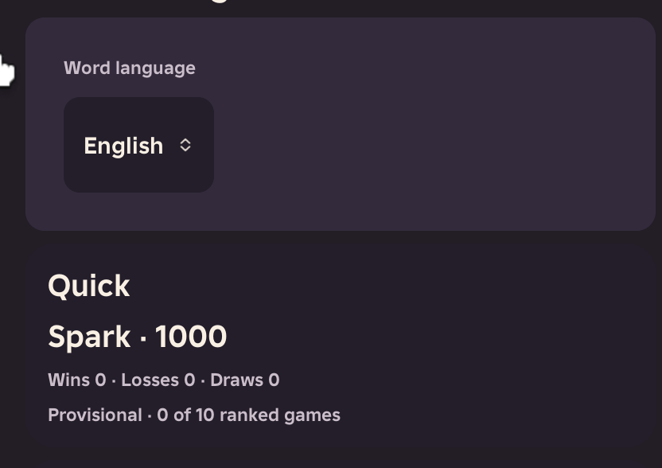

# Before and after: a rank card

A ranked-mode card in a word game. The player checks their standing and how
to improve it.

## Before



```luau
UI.VStack { surface = "panel", padding = "l", gap = "s",
	UI.Text { text = "Quick", textRole = "title" },
	UI.Text { text = `{tier} · {rating}`, textRole = "title" },
	UI.Text { text = `Wins {w} · Losses {l} · Draws {d}`, textRole = "caption" },
	UI.Text { text = `Provisional · {played} of 10 ranked games`, textRole = "caption" },
}
```

`Facet.review` reports `joined-facts` three times, `competing-peaks` for
"Quick" and "Spark · 1000", and `zero-wall`. A reviewer adds what no rule sees:

| Problem | Tag | Move |
|---|---|---|
| The mode name is as loud as the rating | `competing-leads` | Mode as a small `label` eyebrow; the rating is the one `numeral` |
| The rating hides in a sentence with the tier | `numbers-buried` | Rating alone as the numeral; tier name as the `heading` under it |
| The tier has no look | `stat-without-visual` | A tier emblem on a `pane` plate leads the row |
| Three zeros say nothing | `zero-wall` | While placing, hide the record and show the goal |
| Progress is a sentence | `progress-as-text` | Ten segmented pips and "Play 10 ranked games to place your rank." |
| The card sits on a card of nearly the same color | `boxed-everything` | One plate; the language setting moves to a settings row |

## After

[standing.luau](../../examples/standing.luau) builds the card:

- `MODE` eyebrow in `label`, secondary.
- An emblem (the tier glyph at 64 px on a pill `pane`) beside the rating as a
  `numeral`, with the tier name as a `heading` under it.
- While placing: segmented pips and the goal sentence. After placement: three
  stat blocks (glyph, numeral, caption) and a bar toward the next tier.

The after capture belongs here as `rank-card-after.png` once it is taken in
Studio with the game's theme. Review it with the critique-ui skill before
you reuse the layout.
