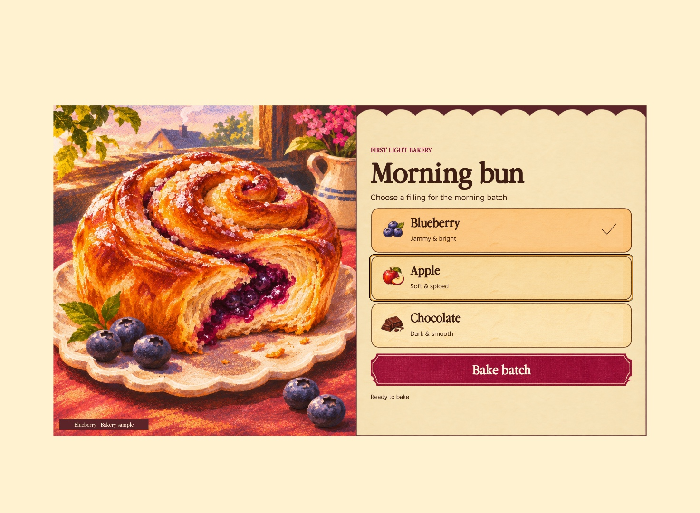
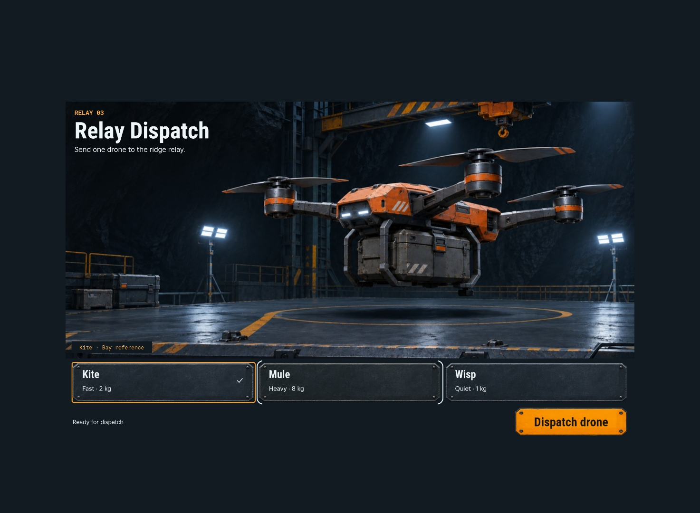
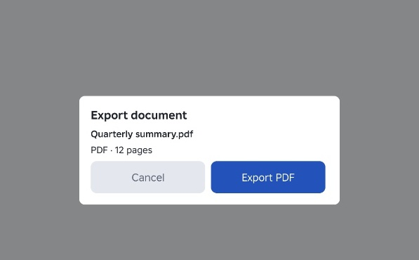

# Carry a visual concept into Facet

Open the [content-detail comparison sheet](images/translation-detail-comparison.png) with an image viewer before reading the code. It places each concept beside its first and revised Studio captures, cropping only the outer desktop canvas. The [full-frame comparison](images/translation-comparison.png) preserves the original framing. Compare the same decision and controls in each image. Reading this page or its links does not show the pixels. If the host cannot display them, report that limit. Open the full images below when you need to inspect small text or painted edges.

Use the comparison to understand a material, hierarchy or control treatment. Keep the current task's reviewed concept beside its runtime capture as the target; do not copy an example's composition into an unrelated game.

These examples assume a bakery choice built around illustrated food, a dispatch choice built around industrial equipment, and a quiet export dialog. Their layouts, type sizes and materials belong to those tasks.

## Morning bun

[Original concept](images/bakery-concept.jpg) · [First Studio translation](images/bakery-first.jpg) · [Phone portrait](images/bakery-phone.jpg) · [Phone landscape](images/bakery-landscape.jpg) · [Confirmation](images/bakery-confirm.jpg) · [Phone confirmation](images/bakery-phone-confirm.jpg)



The first translation loads the illustrated bun and warm plates, but the small ingredients and labels leave the task receding beside the art. The revised recipe page gives the filling names, illustrations and bake ticket their own scale. It keeps brown live text inside the pale paper and reserves a line below the ticket for the previous batch. On a short display, each filling puts its name and flavor on one line.

## Relay Dispatch

[Original concept](images/drone-concept.jpg) · [First Studio translation](images/drone-first.jpg) · [Phone portrait](images/drone-phone.jpg) · [Phone landscape](images/drone-landscape.jpg) · [Confirmation](images/drone-confirm.jpg)



The first translation puts small labels at the top of tall steel plates. The revised desktop fleet strip keeps the bay prominent, cuts the spare plate height and makes the amber action read separately. On a narrow phone, the choices become full-width rows. A portrait illustration preserves the rotors, a quiet shade protects the live mission copy, and a bay label names the pictured Kite. The check shows which drone will dispatch even when focus moves to a peer.

## Export document



A filename, format and page count give the context needed for this example. The neutral dialog keeps that information readable and gives the primary action a clear verb. This sample reports an export request in the UI.

## Use the control contracts

Keep the subject, surface art and labels separate. Bind original uploaded plate art through `theme.assets` and `theme.chrome.control`. Measure the slice rectangle in pixels of the delivered image. Keep bolts and notches inside fixed regions so the stretch does not cut through them. Set `contentInsets` to keep text clear of painted edges and fasteners, then check the smallest rendered plate.

```luau
local theme, report = Facet.themes.define({
    assets = {
        choice = {
            contentId = "rbxassetid://118720989556304",
            sliceCenter = { x0 = 36, y0 = 26, x1 = 732, y1 = 130 },
            sliceScale = 0.48,
        },
    },
    chrome = {
        control = {
            kind = "nineSlice",
            asset = "choice",
            contentInsets = { left = 7, right = 7, top = 1, bottom = 2 },
        },
    },
})
assert(theme and report.ok)
```

Inside `app.mount`, use `app.UI`. Bind persistent selection to the same record that the confirmation reads. Let Facet draw focus separately.

```luau
local chosen = Facet.Compose.cell("Kite")

local kite = UI.Button "Kite" {
    label = "Kite",
    subtitle = "Fast · 2 kg",
    selected = function(use) return use(chosen) == "Kite" end,
    trailingIcon = function(use)
        return if use(chosen) == "Kite" then "checkmark" else ""
    end,
    onActivate = function() chosen:set("Kite") end,
}
```

For a uniquely shaped primary action, the recipes give one `UI.Button` an authored image and live text as children. They set `BackgroundTransparency = 1` on that Button so its native hover and press fill cannot appear outside the authored face. `appearance = "utility"` alone does not keep that fill transparent in every state. Native `:Press` and `:Hover` rules paint the image, and `.facet-disabled` dims the two children. Keep the normal fill for ordinary utility buttons that use it as their state cue.

`UI.Dialog` uses the same app, with a caller-owned `isPresented` cell, `onPresentedChange`, and `role = "default"` and `role = "cancel"` actions. The action stays in the layout while the dialog opens and closes.

[Runnable recipes](recipes/Recipes.luau) · [Theme definitions](recipes/Themes.luau) · [Original artwork and provenance](art/README.md)

To run, install the current Facet package at `ReplicatedStorage.Packages.Facet`. Put `FreshGuidanceExamples.client.luau` in `StarterPlayerScripts` as a LocalScript with `Recipes`, `Themes` and `Art` ModuleScript children. Set the LocalScript's `Example` attribute to `Bakery`, `Drone`, or `Export`. The game recipes simulate accepting the decision. The image IDs require experience access. The source artwork can be uploaded for a different creator.

## Keep the task stable through state changes

The recipes coordinate the parts that must agree. Adapt these relationships to
the current task; do not copy their subjects, dimensions or layout by default.

| Need | Working pattern | Check in the real screen |
| --- | --- | --- |
| Persistent choice | A typed Compose cell drives the preview, `selected`, `trailingIcon`, confirmation and accepted result. Facet draws focus separately. | Select one item, focus it, then focus a peer. The check remains readable and clear of every ring, halo and painted corner. |
| Readable live labels | Theme `contentInsets` reserve space inside the art; labels stay separate from images. | Check the smallest surface with the longest real label. Include focus and selection paint, not only element bounds. |
| Pressed and disabled action | The authored face and live text stay under one transparent `UI.Button`. Native `:Press`, `:Hover` and `.facet-disabled` rules change its paint. A live `enabled` binding also gates the Dialog's default action. | Press with real input and inspect the whole painted silhouette, including transparent corners. Change availability while the screen is open, then try activation. Do not remount the task to change availability. |
| Stable feedback | A reserved feedback region describes the draft until acceptance and then retains the accepted result. The action stays in its layout. | Compare before, pending if used, accepted and failed states. Status text must not push the action or create an awkward unbalanced gap. |
| Confirmation and return | `UI.Dialog` owns modal input; its default and cancel actions share the caller's state. | Open, cancel, reopen and accept once. Check restored focus, retained choice and action bounds after closing. |

The games have Studio checks for keyboard focus, mouse press and disabled
activation, plus Touch acceptance and cancellation in both phone orientations.
The Export example shows the same state relationships with quiet surfaces.
Native controller evidence is still required for a product that supports it;
these examples do not establish that a new screen is correct.

Capture this representative task wide and at the most constrained supported
safe viewport before expanding it. Include selected with focus, selection with
focus elsewhere, pressed state and any confirmation or changing feedback the
task uses. Inspect the captures yourself, then include them in the early
runtime critique. A missing state stays unverified even if the idle screen
looks good. A passive display needs only the states it actually has.

The game screenshots show the full Studio capture at each viewport. The desktop comparisons use the same framing. Revised examples demonstrate specific improvements, not a universal quality threshold; keep the current game's reviewed target as the visual standard.
